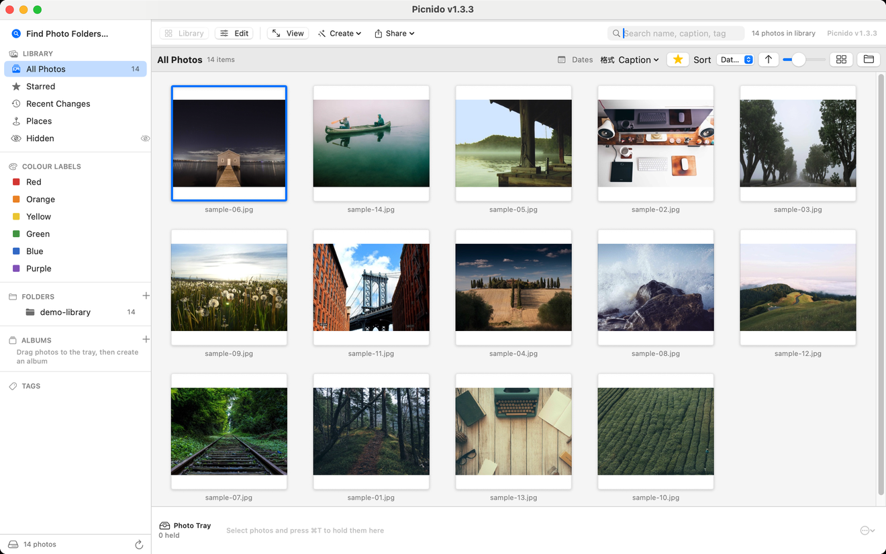
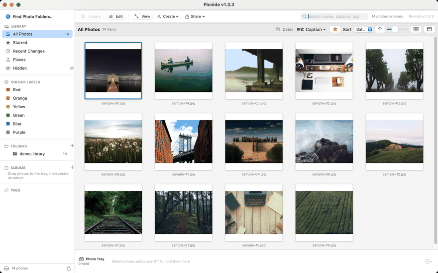
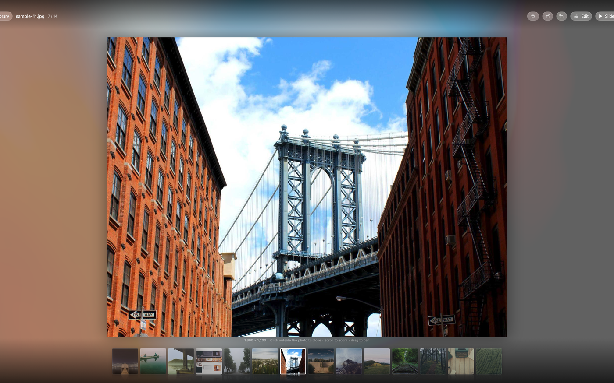

# Picnido

**A photo browser for macOS that treats your folders as the library — no import, no cloud, no catalogue that owns your files.**

Picnido is a native SwiftUI photo browser in the spirit of Google's Picasa: point it at the folders you already have, and it shows you what is in them. Nothing is copied, nothing is moved, nothing is uploaded. Close it and your disk looks exactly as it did before.





The name is `pic` + `nido` — Italian for *nest*. Picasa was `pic` + `casa`, *house*: same idea, a home for your pictures, with no claim to the original.

---

## Why this exists

Picasa was discontinued in 2016. Its Mac version was never as good as the Windows one, and the things that made it pleasant were never really replaced:

- It opened **a folder**, not a database. No 20-minute import, no "consolidating library", no asking where the originals went.
- It was **fast on a boring machine** and did not need a network.
- It let you **star, label and caption** a photo without converting anything or moving it into a proprietary structure.

Picnido is an independent implementation of that model on macOS, written against the files on disk rather than a library format of its own. Everything it knows about a photo it can relearn by looking at the photo.

---

## Features

### Library

- **Folder-first.** Add any number of folders; the tree in the sidebar *is* the library. Subfolders appear as you expand them.
- **Instant reopen.** A SQLite catalogue caches what has been learned about each file, so a relaunch paints the grid in tens of milliseconds and only then reconciles in the background.
- **Sidebar that means something:** All Photos, Starred, Recent Changes, Places, Hidden, your colour labels, the folder tree, albums, tags.
- **Grid that suits the content:** adjustable thumbnail size, square or masonry layout, optional folder headings, captions under each tile.
- **Photo Tray** — a holding area for batch work: gather a few photos from anywhere, then act on all of them at once.
- **Search** across filename, caption and tags, plus a date filter.

### Viewer



- Full-screen panel with the photo centred in the space between the toolbar and the filmstrip — and it does not jump when the chrome auto-hides.
- Filmstrip of the current folder, zoom and pan, and a readout of the real pixel size.
- Three ways out: click outside the photo, the button in the corner, or `Esc`.

### Editing

Non-destructive adjustments applied at display and export time — the original file is untouched until you say so:

crop · straighten · fill light · highlights · shadows · colour temperature · saturation · sharpening · black & white · Sepia · film grain · vignette · plus Picasa's *I'm Feeling Lucky* one-shot fix.

Effects can be **copied and pasted between photos**, applied to a whole selection, and undone.

### Animated images

Animated **WebP**, **APNG** and **GIF** play in the grid, the filmstrip and the viewer, through a decoder budget that keeps the window responsive. This is what `Vendor/libwebp` is for — the build links libwebp **statically**, so the app has no external image dependency.

### Create

- **Collage** — several photos on one sheet, with layouts and spacing you can adjust.
- **Movie** — a slideshow rendered to a video file, with music.
- **Poster** and **Frame** — print-oriented compositions.
- **HTML gallery** — export a folder as a self-contained browsable web page, generated in code (no template files to install).
- **Export** — resize, re-encode, rename, and write metadata.

### Organise

- Rename, move, copy, delete — batched, with a preview of what will happen.
- Adjust the capture date when a camera's clock was wrong.
- **Duplicate finder** that compares content, not filenames.
- Stars, colour labels and captions are written to a `.picasa.ini` sidecar in the folder, so they survive a reinstall and stay readable by other tools.

---

## Installation

### Download

Two builds ship with every release. Pick the one for your machine:

| Mac | Asset |
|---|---|
| Apple Silicon (M1 and later) | `Picnido-1.3.3.zip` |
| Intel | `Picnido-1.3.3-x86.zip` |

Download from [Releases](https://github.com/sosoddosgithub/picnido/releases), unzip, and drag `Picnido.app` to `/Applications`. Both bundles carry the same identifier, so install one or the other — not both.

**The build is ad-hoc signed, not notarised** (there is no paid Apple Developer account behind it). macOS will refuse the first launch with *"Picnido can't be opened because Apple cannot check it for malicious software"*. That is Gatekeeper, not a crash. To allow it:

- **Right-click the app → Open → Open**, or
- `System Settings → Privacy & Security → Open Anyway`, or
- `xattr -dr com.apple.quarantine /Applications/Picnido.app`

### Requirements

| | |
|---|---|
| macOS | **14.0 Sonoma** or later |
| Architecture | Apple Silicon, and Intel as a separate self-contained build |
| Disk | ~9 MB for the app |

The Intel build needs macOS 14 too — the code uses `@Observable`, which does not exist in macOS 13. If your Mac tops out at macOS 13, this will not run, and no amount of Rosetta changes that.

---

## Getting started

1. **Launch Picnido.** The first window is empty by design.
2. **Find Photo Folders…** (`⇧⌘F`) and pick a folder — `~/Pictures`, an external drive, a network share. Pick as many as you like.
3. **Wait for the first scan.** Thumbnails are built once and cached; the second launch is immediate.
4. **Click a photo** to open the viewer, or press `⌘2` to edit.

Nothing is imported. If you delete a file in Finder, it disappears from Picnido on the next scan — and if you delete a folder from the sidebar, the files are still exactly where they were.

### Keyboard

| Shortcut | Action |
|---|---|
| `⇧⌘F` | Find photo folders |
| `⇧⌘I` | Import a folder |
| `⌘F` | Search |
| `⌘1` / `⌘2` / `⌘↵` | Library / Edit / Photo viewer |
| `F2` | Rename |
| `⇧⌘D` | Adjust photo date |
| `⇧⌘E` | Export |
| `⌥⌘H` / `⇧⌘H` | Hide photo / show hidden |
| `⇧⌘C` / `⇧⌘V` | Copy / paste all effects |
| `⌘Z` / `⇧⌘Z` | Undo / redo edit |
| `⌘P` | Print |
| `⌘/` | Every shortcut, in one panel |
| `Esc` | Close the viewer |

In the viewer: scroll to zoom, drag to pan, `←`/`→` to move through the filmstrip.

---

## Supported formats

41 extensions, split into two families:

| Family | Count | Examples |
|---|---|---|
| Common images | 15 | `jpg` `jpeg` `png` `gif` `tif` `tiff` `bmp` `heic` `heif` `webp` `avif` `psd` `ico` `tga` `jxl` |
| Camera raw | 26 | `cr2` `cr3` `nef` `nrw` `arw` `srf` `sr2` `raf` `orf` `rw2` `rwl` `pef` `dng` `srw` `x3f` `3fr` `fff` `iiq` `mos` `mrw` `erf` `kdc` `dcr` `raw` `nefx` `mef` |

Animated WebP, APNG and GIF are decoded as animations, not as their first frame.

The list lives in one place — `Sources/Picnido/Model/FileTypes.swift` — and drives the scan, the open panel and the *Set as Default* action together.

---

## Building from source

Only the Command Line Tools are needed; there is no Xcode project.

```bash
git clone https://github.com/<you>/picnido.git
cd picnido
./build_app.sh release          # → dist/Picnido.app
./build_app.sh release && open dist/Picnido.app
```

`build_app.sh` builds with SwiftPM, assembles the bundle, copies the four `.lproj` tables, ad-hoc signs it, and registers it with LaunchServices. Run it rather than `swift build` — the script passes the sandbox and cache paths that SwiftPM needs on a plain CLT install.

**Intel build:**

```bash
./build_app_x86.sh release      # → dist-x86/Picnido.app
```

This cross-compiles for `x86_64` and refuses to assemble the bundle if the payload is not actually x86_64. It stages into `dist-x86/` so it never overwrites the arm build, and it deliberately does **not** register the bundle with LaunchServices: a second copy carrying the same bundle identifier would compete with your main install for which app opens a JPEG. It has only ever been exercised under Rosetta 2 on Apple Silicon, never on a real Intel Mac.

`Vendor/libwebp` holds libwebp 1.6.0 as **fat** static libraries (arm64 + x86_64), so both builds use the same vendored bytes.

---

## Privacy

Picnido makes **no network requests**. There is no account, no telemetry, no crash reporter, no update check, no analytics, and no code that could send a photo anywhere. The only things it writes are:

- `~/Library/Application Support/Picnido/` — `library.json` (settings and folder list) and `index.db` (the metadata catalogue)
- `~/Library/Caches/Picnido/thumbs/` — JPEG thumbnails, safe to delete at any time
- `.picasa.ini` inside a folder — only when you set a star, label or caption, and only that folder

Sandbox is **not** enabled: the app needs to read arbitrary folders and external drives, which is the whole point.

---

## Relationship to Picasa

Picnido is an **independent, unofficial** project. It is not affiliated with, endorsed by, or derived from Google. *Picasa* is a trademark of Google LLC; the name was retired along with the product in 2016, and this project does not use it.

The app is **format-compatible** with Picasa in one narrow, deliberate way: it reads and writes the `.picasa.ini` sidecar that the Windows build left in photo folders. That is a file format, not branding, and it means switching to Picnido does not throw away stars and captions you set years ago.

No code, resources or artwork from Picasa are included. The interface is built from SwiftUI primitives, the gallery exporter writes its own HTML, and the demo images in this README are freely licensed stock photos.

---

## Known limitations

- **Ad-hoc signed**, so Gatekeeper needs one manual approval per machine.
- **No face recognition**, no geotag map, no cloud sync, no mobile app.
- **Videos are listed but not played** — they open in QuickTime.
- **Intel build is cross-compiled and has never been run on real Intel hardware.** It is verified under Rosetta 2 on Apple Silicon, which is not the same thing.
- Raw decoding uses ImageIO, so it is only as good as the system's support for your camera.
- Interface is in **English, 简体中文, 日本語, 한국어**; the menu bar itself follows the system language rather than the in-app picker.

---

## Contributing

Issues and pull requests are welcome. Two things worth knowing before you send one:

- The **verification scripts come first**. `work/verify_*.sh` drive the app from outside the process — window lists, geometry reports, PNG captures — because "it looks right" is not a check. A change that alters layout or behaviour is expected to come with a rule that can fail.
- **Read the comment above the line you are about to change.** The comments here explain *why* a thing is the way it is, and the ones carrying a `⚠️` mark a regression that already happened once. Several of them exist because the obvious implementation was tried first and was wrong.

---

## Licence

MIT — see [LICENSE](LICENSE).

Bundled third-party code:

| Component | Licence |
|---|---|
| libwebp 1.6.0 (`Vendor/libwebp`) | BSD 3-Clause, © Google Inc. |

---

<p align="center"><sub>Not affiliated with Google. Picasa is a trademark of Google LLC.</sub></p>
