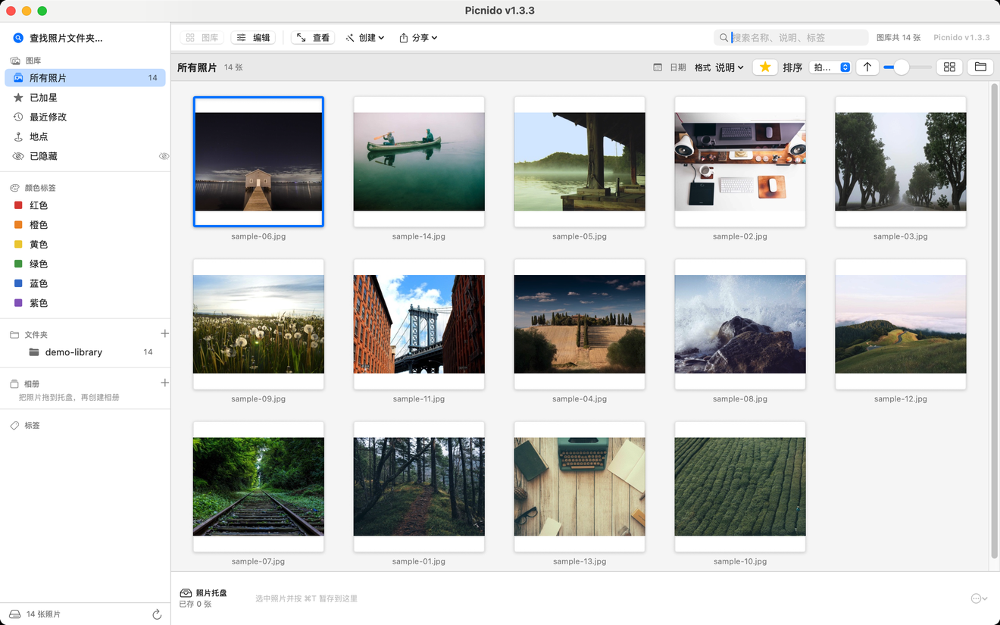

# Picnido — 图巢

**一个把「文件夹」当作照片库的 macOS 照片浏览器。不导入、不上传、不把你的照片搬进某个数据库。**




Picnido 是照着 Google Picasa 那套体验做的原生 macOS 应用：你指给它几个已有的文件夹，它就把里面的照片摆出来。不复制、不移动、不联网——关掉它，磁盘上一切和你打开之前一模一样。

名字是 `pic` + `nido`，意大利语「巢」。Picasa 是 `pic` + `casa`（家），同一个思路：给照片一个自己的窝。

[English README](README.md)

---

## 为什么做这个

Picasa 在 2016 年停止维护。它的 Mac 版本从来不如 Windows 版好用，而真正让人觉得舒服的几点，一直没被替代：

- 它打开的是**一个文件夹**，不是一个数据库。没有二十分钟的「正在导入」，没有「正在整合图库」，也不会问你原图去哪儿了。
- 它在**一台普通机器上就很快**，而且不需要网络。
- 它能让你给一张照片**打星、贴标签、写说明**，而不必转换格式、不必搬进某个私有结构。

Picnido 是在 macOS 上从零重写的这一套，直接对着磁盘上的文件工作，而不是自己造一个图库格式。它对一张照片知道的所有事情，都能靠重新看一遍那张照片再学回来。

---

## 功能

### 库

- **文件夹即图库。** 想加几个文件夹就加几个，侧边栏那棵树**就是**图库，展开子文件夹就出现。
- **秒开。** SQLite 目录缓存了每个文件已知的信息，重新启动时几十毫秒就把网格画出来，之后才在后台对账。
- **有意义的侧边栏：** 所有照片、已加星、最近修改、地点、已隐藏、颜色标签、文件夹树、相册、标签。
- **随内容变的网格：** 缩略图大小可调、方形或瀑布流、可选文件夹标题、格子下方显示说明。
- **照片托盘** —— 批处理用的暂存区：从任何地方挑几张放进来，再一次性处理。
- **搜索**文件名、说明和标签，另有一个日期筛选。

### 查看器


- 全屏面板，照片在「工具行底边 ↔ 胶片条顶边」这条带里居中——而且工具行自动隐藏时它**不会跳**。
- 当前文件夹的胶片条、缩放平移、真实像素尺寸读数。
- 三条退出路径：点照片外、点角上的按钮、按 `Esc`。

### 编辑

所有调整都是非破坏性的，只有你按下保存才写回文件：

裁剪 · 拉直 · 补光 · 高光 · 阴影 · 色温 · 饱和度 · 锐化 · 黑白 · 褐色 · 胶片颗粒 · 暗角 · 以及 Picasa 那个「手气不错」一键优化。

效果可以在照片之间**复制粘贴**、批量套用，也都能撤销。

### 动图

动态 **WebP**、**APNG**、**GIF** 在网格、胶片条和查看器里都会动，带一个解码预算保证窗口不卡。`Vendor/libwebp` 就是干这个的——libwebp 是**静态链接**的，所以应用不依赖任何外部图像库。

### 创建

- **拼贴** —— 多张照片拼一张，版式和间距可调。
- **电影** —— 把幻灯片渲染成视频文件，可以配乐。
- **海报** 与 **相框** —— 面向打印的版式。
- **HTML 画廊** —— 把一个文件夹导出成能直接打开的自包含网页，页面由代码生成（不需要装模板）。
- **导出** —— 缩放、重编码、重命名、写元数据。

### 整理

- 重命名、移动、复制、删除——批量执行，执行前先给你看会发生什么。
- 相机时钟不准时，调整拍摄日期。
- **重复文件查找**，比的是内容不是文件名。
- 星标、颜色标签、说明会写进文件夹里的 `.picasa.ini`，重装不丢，别的工具也读得懂。

---

## 安装

### 下载

每个版本都出两个包，按机器选：

| 机器 | 文件 |
|---|---|
| Apple Silicon（M1 及以后） | `Picnido-1.3.3.zip` |
| Intel | `Picnido-1.3.3-x86.zip` |

到 [Releases](https://github.com/sosoddosgithub/picnido/releases) 下载，解压后把 `Picnido.app` 拖进 `/Applications`。两个包 bundle id 相同，装一个就行，不要同时装。

**这是 ad-hoc 签名，没有公证**（背后没有付费的 Apple 开发者账号）。首次启动 macOS 会拦下来说「无法验证开发者」。那是 Gatekeeper，不是崩溃。放行方法：

- **右键点应用 → 打开 → 打开**，或
- `系统设置 → 隐私与安全性 → 仍要打开`，或
- `xattr -dr com.apple.quarantine /Applications/Picnido.app`

### 系统要求

| | |
|---|---|
| macOS | **14.0 Sonoma** 或更高 |
| 架构 | Apple Silicon；Intel 另有独立构建 |
| 磁盘 | 应用本体约 9 MB |

Intel 版同样要求 macOS 14——代码用了 `@Observable`，macOS 13 里不存在。如果你的机器最高只能升到 13，那装不上，Rosetta 也帮不了。

---

## 上手

1. **打开 Picnido。** 第一个窗口是空的，这是设计如此。
2. **查找照片文件夹…**（`⇧⌘F`），选一个文件夹——`~/图片`、外接硬盘、网络共享都行，想加几个加几个。
3. **等第一次扫描。** 缩略图只做一次并缓存，第二次启动是瞬时的。
4. **点一张照片**进查看器，或按 `⌘2` 进编辑。

什么都没有被导入。你在 Finder 里删掉一个文件，下次扫描它就消失了；你从侧边栏移除一个文件夹，文件还在原处，一个字节都没动。

### 快捷键

| 快捷键 | 动作 |
|---|---|
| `⇧⌘F` | 查找照片文件夹 |
| `⇧⌘I` | 导入文件夹 |
| `⌘F` | 搜索 |
| `⌘1` / `⌘2` / `⌘↵` | 库 / 编辑 / 查看器 |
| `F2` | 重命名 |
| `⇧⌘D` | 调整照片日期 |
| `⇧⌘E` | 导出 |
| `⌥⌘H` / `⇧⌘H` | 隐藏照片 / 显示已隐藏 |
| `⇧⌘C` / `⇧⌘V` | 复制 / 粘贴全部效果 |
| `⌘Z` / `⇧⌘Z` | 撤销 / 重做编辑 |
| `⌘P` | 打印 |
| `⌘/` | 一个面板看全部快捷键 |
| `Esc` | 关闭查看器 |

查看器里：滚轮缩放、拖动平移、`←`/`→` 翻胶片条。

---

## 支持的格式

41 个扩展名，分两族：

| 家族 | 数量 | 例子 |
|---|---|---|
| 常见图片 | 15 | `jpg` `jpeg` `png` `gif` `tif` `tiff` `bmp` `heic` `heif` `webp` `avif` `psd` `ico` `tga` `jxl` |
| 相机 RAW | 26 | `cr2` `cr3` `nef` `nrw` `arw` `srf` `sr2` `raf` `orf` `rw2` `rwl` `pef` `dng` `srw` `x3f` `3fr` `fff` `iiq` `mos` `mrw` `erf` `kdc` `dcr` `raw` `nefx` `mef` |

动态 WebP、APNG、GIF 会按动画解码，不会只给你第一帧。

这份清单只有一处定义——`Sources/Picnido/Model/FileTypes.swift`——扫描、打开面板和「设为默认」读的都是它。

---

## 从源码构建

只需要命令行工具，不需要 Xcode 工程。

```bash
git clone https://github.com/<you>/picnido.git
cd picnido
./build_app.sh release          # → dist/Picnido.app
open dist/Picnido.app
```

`build_app.sh` 会用 SwiftPM 编译、组装 bundle、拷四份 `.lproj`、ad-hoc 签名、注册给 LaunchServices。请跑这个脚本而不是直接 `swift build`——脚本会补上纯命令行工具环境下 SwiftPM 需要的沙箱和缓存参数。

**Intel 版：**

```bash
./build_app_x86.sh release      # → dist-x86/Picnido.app
```

交叉编译到 `x86_64`，如果产物不是 `x86_64` 就**拒绝组装**。产物落在 `dist-x86/`，不会覆盖 ARM 版；它刻意**不**注册给 LaunchServices：第二个同 bundle id 的副本会和你主安装抢「谁来打开 JPEG」。这个包只在 Apple Silicon 上通过 Rosetta 2 跑过，没上过真 Intel 机器。

`Vendor/libwebp` 里是 libwebp 1.6.0 的 **fat** 静态库（arm64 + x86_64），两个架构用的是同一份字节。

---

## 隐私

Picnido **不发起任何网络请求**。没有账号、没有遥测、没有崩溃上报、没有更新检查、没有统计，也没有任何能把照片发出去的代码。它只写三处：

- `~/Library/Application Support/Picnido/` —— `library.json`（设置和文件夹列表）和 `index.db`（元数据目录）
- `~/Library/Caches/Picnido/thumbs/` —— JPEG 缩略图，随时可以删
- 文件夹里的 `.picasa.ini` —— 只在你设置星标、标签或说明时写，且只写那一个文件夹

**没有开启 Sandbox**：应用需要读任意文件夹和外接硬盘，而这正是它的用途。

---

## 与 Picasa 的关系

Picnido 是一个**独立的、非官方**项目，与 Google 没有隶属、背书或衍生关系。*Picasa* 是 Google LLC 的商标，随产品在 2016 年一起退役，本项目不使用它。

只有一处刻意的**格式兼容**：它会读写 Windows 版 Picasa 留在照片文件夹里的 `.picasa.ini`。那是一种文件格式，不是品牌，好处是你多年前打的星标和写的说明，换到 Picnido 不会丢。

项目里不含任何来自 Picasa 的代码、资源或美术素材。界面由 SwiftUI 原语搭出来，相册导出器写自己的 HTML，README 里的演示图用的是自由授权的图库照片。

---

## 已知限制

- **ad-hoc 签名**，每台机器首次启动要手动放行一次。
- **没有人脸识别**、没有地理标记地图、没有云同步、没有移动端。
- **视频只列不播**——用 QuickTime 打开。
- **Intel 版是交叉编译的，从未在真实 Intel 机器上跑过。** 它只在 Apple Silicon 上通过 Rosetta 2 验证过，这两件事不是一回事。
- RAW 解码走 ImageIO，你的相机支持得好不好取决于系统。
- 界面有 **英语 / 简体中文 / 日语 / 韩语**；但菜单栏跟的是系统语言，不跟应用内选择器。

---

## 参与

Issues 和 PR 都欢迎。提交之前有两点值得知道：

- **判据先行。** `work/verify_*.sh` 从进程外驱动应用——窗口列表、几何报告、PNG 抓帧——因为「看起来对」不算检查。改动布局或行为的 PR，应该带一条**能失败**的判据。
- **改哪一行之前，先读它上面的注释。** 这里的注释解释的是「为什么必须这样写」，带 `⚠️` 的那几条，标记的是**已经踩过一次**的回归。其中不少是因为「想当然的写法」先被实现过、然后错了。

---

## 许可

MIT，见 [LICENSE](LICENSE)。

随附的第三方代码：

| 组件 | 许可 |
|---|---|
| libwebp 1.6.0（`Vendor/libwebp`） | BSD 3-Clause，© Google Inc. |

---

<p align="center"><sub>与 Google 无关。Picasa 是 Google LLC 的商标。</sub></p>
